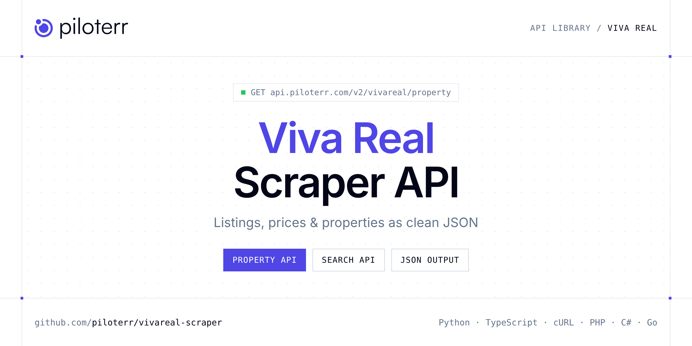

<p align="center">
  <a href="https://www.piloterr.com"></a>
</p>

# Viva Real Scraper API

[](https://discord.gg/CFj3ph8aHU) [](https://app.piloterr.com) [](https://app.piloterr.com/openapi) [](LICENSE)

The **Piloterr Viva Real Scraper API** lets you extract public data from Viva Real as **clean, structured JSON** — no proxies, headless browsers or HTML parsing to maintain. Endpoints available in production:

- **Viva Real Property API** — Read one Viva Real property from its URL.
- **Viva Real Search API** — Search Viva Real by city and operation, sale or rent.

Use it for property price monitoring, market analytics, investment sourcing or rental yield models.

| Endpoint | Path | Credits | What you get |
|---|---|---|---|
| [Viva Real Property API](#viva-real-property-api) | `/v2/vivareal/property` | 1 | Read one Viva Real property from its URL. The price follows the operation of that URL, so a sale link stays a sale price. |
| [Viva Real Search API](#viva-real-search-api) | `/v2/vivareal/search` | 1 | Search Viva Real by city and operation, sale or rent. Page with pagina. Development cards and 'from' prices are left out. |

## Table of contents

- [How it works](#how-it-works)
- [Viva Real Property API](#viva-real-property-api)
- [Viva Real Search API](#viva-real-search-api)
- [Code examples in other languages](#code-examples-in-other-languages)
- [Practical use cases](#practical-use-cases)
- [Why Piloterr?](#why-piloterr)
- [FAQ](#faq)
- [Official SDKs](#official-sdks)
- [Related scrapers](#related-scrapers)
- [Support](#support)

## How it works

1. **Create a free Piloterr account** and copy your API key from the [dashboard](https://app.piloterr.com).
2. **Send a `GET` (or `POST`) request** to `https://api.piloterr.com/v2/...` with the header `x-api-key: YOUR_API_KEY`.
3. **Receive structured JSON** — Piloterr handles rendering, proxies, retries and parsing.

```bash
export PILOTERR_API_KEY="your-api-key"
pip install requests        # Python
# TypeScript: Node.js 18+ (native fetch), run with `npx tsx file.ts`
```

> Every endpoint accepts both `GET` (query string) and `POST` (JSON body with the same fields).

## Viva Real Property API

Read one Viva Real property from its URL. The price follows the operation of that URL, so a sale link stays a sale price.

`GET | POST https://api.piloterr.com/v2/vivareal/property` · **1 credit per request** · [Full reference](https://app.piloterr.com/openapi)

### Request parameters

| Parameter | Type | Required | Description |
|---|---|---|---|
| `query` | string | ✅ | Viva Real listing URL under /imovel/ with an id- number. |

### Python example

```python
import json
import os
import requests

response = requests.get(
    "https://api.piloterr.com/v2/vivareal/property",
    headers={"x-api-key": os.environ["PILOTERR_API_KEY"]},
    params={
        "query": "https://www.vivareal.com.br/imovel/apartamento-3-quartos-brooklin-zona-sul-sao-paulo-com-garagem-186m2-venda-RS3710000-id-2776423622/",
    },
    timeout=120,
)
response.raise_for_status()
data = response.json()

print(json.dumps(data, indent=2, ensure_ascii=False)[:2000])
```

### TypeScript example

```typescript
type VivaRealProperty = {
  id?: string;
  url?: string;
  area?: number;
  city?: string;
  iptu?: number;
  floor?: unknown;
  price?: number;
  title?: string;
  images?: string[];
  suites?: number;
  address?: string;
  bedrooms?: number;
  currency?: string;
  amenities?: string[];
  bathrooms?: number;
  image_url?: string;
  operation?: string;
  reference?: string;
  state_code?: string;
  condominium?: number;
  description?: string;
  iptu_display?: string;
  neighborhood?: string;
  published_at?: string;
  price_display?: string;
  [key: string]: unknown;
};

const params = new URLSearchParams({
  "query": "https://www.vivareal.com.br/imovel/apartamento-3-quartos-brooklin-zona-sul-sao-paulo-com-garagem-186m2-venda-RS3710000-id-2776423622/",
});

const response = await fetch(`https://api.piloterr.com/v2/vivareal/property?${params}`, {
  headers: { "x-api-key": process.env.PILOTERR_API_KEY! },
});
if (!response.ok) throw new Error(`Piloterr error ${response.status}: ${await response.text()}`);

const data = (await response.json()) as VivaRealProperty;

console.log(JSON.stringify(data, null, 2).slice(0, 2000));
```

<details>
<summary><b>POST variant</b></summary>

```http
POST https://api.piloterr.com/v2/vivareal/property
x-api-key: YOUR_API_KEY
Content-Type: application/json

{"query": "https://www.vivareal.com.br/imovel/apartamento-3-quartos-brooklin-zona-sul-sao-paulo-com-garagem-186m2-venda-RS3710000-id-2776423622/"}
```
</details>

### Output example

Example response from the API reference, abridged — real values depend on the page you scrape.

```json
{
  "id": "2776423622",
  "url": "https://www.vivareal.com.br/imovel/apartamento-3-quartos-brooklin-zona-sul-sao-paulo-com-garagem-186m2-venda-RS3710000-id-2776423622/",
  "area": 186,
  "city": "São Paulo",
  "iptu": 917,
  "floor": null,
  "price": 3710000,
  "title": "Apartamento com 3 Quartos à venda, 186m² - Brooklin",
  "images": [
    "https://resizedimgs.vivareal.com/img/vr-listing/c16fea316fbef741a3dacf22121412b1/apartamento-com-3-quartos-a-venda-186m-no-brooklin-sao-p…",
    "https://resizedimgs.vivareal.com/img/vr-listing/3b1700b6695469ff6130dfa4dd7bd29a/apartamento-com-3-quartos-a-venda-186m-no-brooklin-sao-p…"
  ],
  "suites": 2,
  "address": "Rua Nova York, 161 - Brooklin, São Paulo - SP",
  "bedrooms": 3,
  "currency": "BRL",
  "amenities": [
    "Mobiliado",
    "Aceita animais"
  ],
  "bathrooms": 3,
  "image_url": "https://resizedimgs.vivareal.com/img/vr-listing/c16fea316fbef741a3dacf22121412b1/apartamento-com-3-quartos-a-venda-186m-no-brooklin-sao-p…",
  "operation": "sale",
  "reference": "LR4127",
  "state_code": "SP",
  "condominium": 2500,
  "description": "Apartamento alto padrão de 3 dormitórios sendo 1 suíte master com closet, home theater integrado, sala com living para 2 ambientes, cozin…",
  "iptu_display": "R$ 917",
  "neighborhood": "Brooklin",
  "published_at": "2025-02-03",
  "price_display": "R$ 3.710.000"
}
```

### Response fields

| Field | Type | Description |
|---|---|---|
| `id` | string |  |
| `url` | string |  |
| `area` | integer |  |
| `city` | string |  |
| `iptu` | integer |  |
| `floor` | object |  |
| `price` | integer |  |
| `title` | string |  |
| `images` | string[] |  |
| `suites` | integer |  |
| `address` | string |  |
| `bedrooms` | integer |  |
| `currency` | string |  |
| `amenities` | string[] |  |
| `bathrooms` | integer |  |
| `image_url` | string |  |
| `operation` | string |  |
| `reference` | string |  |
| `state_code` | string |  |
| `condominium` | integer |  |
| `description` | string |  |
| `iptu_display` | string |  |
| `neighborhood` | string |  |
| `published_at` | string |  |
| `price_display` | string |  |

## Viva Real Search API

Search Viva Real by city and operation, sale or rent. Page with pagina. Development cards and 'from' prices are left out.

`GET | POST https://api.piloterr.com/v2/vivareal/search` · **1 credit per request** · [Full reference](https://app.piloterr.com/openapi)

### Request parameters

| Parameter | Type | Required | Description |
|---|---|---|---|
| `query` | string | ✅ | City, City plus UF, or a Viva Real search URL. |
| `operation` | string | — | Sale or rent when query is a city. |
| `property_type` | string | — | Optional type when query is a city. |
| `page` | number | — | Page from 1. Placeholder 2. Viva Real receives this as pagina=2. Page 1 and page 2 return different listings. A few featured ids can repeat. Most ids on page 2 are new. |

### Python example

```python
import json
import os
import requests

response = requests.get(
    "https://api.piloterr.com/v2/vivareal/search",
    headers={"x-api-key": os.environ["PILOTERR_API_KEY"]},
    params={
        "query": "S\u00e3o Paulo",
    },
    timeout=120,
)
response.raise_for_status()
data = response.json()

print(json.dumps(data, indent=2, ensure_ascii=False)[:2000])
```

### TypeScript example

```typescript
type VivaRealSearch = {
  results?: {
    id?: string;
    url?: string;
    area?: number;
    city?: string;
    iptu?: number;
    price?: number;
    title?: string;
    address?: string;
    bedrooms?: number;
    currency?: string;
    bathrooms?: number;
    image_url?: string;
    operation?: string;
    state_code?: string;
    condominium?: number;
    neighborhood?: string;
    price_display?: string;
    property_type?: string;
    parking_spaces?: number;
  }[];
  pagination?: {
    next?: string;
    page?: number;
    per_page?: number;
    total_pages?: number;
    total_results?: number;
  };
};

const params = new URLSearchParams({
  "query": "S\u00e3o Paulo",
});

const response = await fetch(`https://api.piloterr.com/v2/vivareal/search?${params}`, {
  headers: { "x-api-key": process.env.PILOTERR_API_KEY! },
});
if (!response.ok) throw new Error(`Piloterr error ${response.status}: ${await response.text()}`);

const data = (await response.json()) as VivaRealSearch;

console.log(JSON.stringify(data, null, 2).slice(0, 2000));
```

<details>
<summary><b>POST variant</b></summary>

```http
POST https://api.piloterr.com/v2/vivareal/search
x-api-key: YOUR_API_KEY
Content-Type: application/json

{"query": "São Paulo"}
```
</details>

### Output example

Example response from the API reference, abridged — real values depend on the page you scrape.

```json
{
  "results": [
    {
      "id": "2910482320",
      "url": "https://www.vivareal.com.br/imovel/apartamento-4-quartos-tatuape-zona-leste-sao-paulo-com-garagem-225m2-venda-RS4250000-id-2910482320/",
      "area": 225,
      "city": "São Paulo",
      "iptu": 1293,
      "price": 4250000,
      "title": "Apartamento para comprar com 225 m², 4 quartos, 5 banheiros, 4 vagas em Chácara Califórnia, São Paulo",
      "address": "Rua Antônio de Lucena, Chácara Califórnia, São Paulo - SP",
      "bedrooms": 4,
      "currency": "BRL",
      "bathrooms": 5,
      "image_url": "https://resizedimgs.vivareal.com/img/vr-listing/f343296aa94fef7c6d452a62715150c6/apartamento-com-4-quartos-a-venda-225m-no-chacara-califo…",
      "operation": "sale",
      "state_code": "SP",
      "condominium": 3072,
      "neighborhood": "Chácara Califórnia",
      "price_display": "R$ 4.250.000",
      "property_type": "apartment",
      "parking_spaces": 4
    }
  ],
  "pagination": {
    "next": "https://www.vivareal.com.br/venda/sp/sao-paulo/?onde=%2CS%C3%A3o+Paulo%2CS%C3%A3o+Paulo%2C%2C%2C%2C%2Ccity%2CBR%3ESao+Paulo%3ENULL%3ESao+…",
    "page": 1,
    "per_page": 30,
    "total_pages": 27853,
    "total_results": 835576
  }
}
```

### Response fields

| Field | Type | Description |
|---|---|---|
| `results[]` | object[] |  |
| `results[].id` | string |  |
| `results[].url` | string |  |
| `results[].area` | integer |  |
| `results[].city` | string |  |
| `results[].iptu` | integer |  |
| `results[].price` | integer |  |
| `results[].title` | string |  |
| `results[].address` | string |  |
| `results[].bedrooms` | integer |  |
| `results[].currency` | string |  |
| `results[].bathrooms` | integer |  |
| `results[].image_url` | string |  |
| `results[].operation` | string |  |
| `results[].state_code` | string |  |
| `results[].condominium` | integer |  |
| `results[].neighborhood` | string |  |
| `results[].price_display` | string |  |
| `results[].property_type` | string |  |
| `results[].parking_spaces` | integer |  |
| `pagination` | object |  |
| `pagination.next` | string |  |
| `pagination.page` | integer |  |
| `pagination.per_page` | integer |  |
| `pagination.total_pages` | integer |  |

## Code examples in other languages

Ready-to-run examples live in the [`examples/`](examples) folder. Each one reads your key from the `PILOTERR_API_KEY` environment variable.

| Language | Property | Search |
|---|---|---|
| cURL (Bash) | [`property`](examples/curl/property.sh) | [`search`](examples/curl/search.sh) |
| PHP | [`property`](examples/php/property.php) | [`search`](examples/php/search.php) |
| C# | [`property`](examples/csharp/Property.cs) | [`search`](examples/csharp/Search.cs) |
| Go | [`property`](examples/go/property.go) | [`search`](examples/go/search.go) |
| Java | [`property`](examples/java/PropertyExample.java) | [`search`](examples/java/SearchExample.java) |
| Ruby | [`property`](examples/ruby/property.rb) | [`search`](examples/ruby/search.rb) |
| Node.js | [`property`](examples/nodejs/property.mjs) | [`search`](examples/nodejs/search.mjs) |

## Practical use cases

- **Price monitoring** — Track asking prices and price drops per area.
- **Market analytics** — Measure inventory, days on market and price per m² / sqft.
- **Investment sourcing** — Detect undervalued properties as soon as they are listed.
- **Rental yield models** — Combine sale and rent listings to estimate yields.
- **Proptech products** — Power portals, valuation tools and alerts with structured listings.

## Why Piloterr?

- **No infrastructure** — no proxies, headless browsers or CAPTCHA solving to run yourself.
- **Structured JSON** — stable, documented fields instead of brittle HTML selectors.
- **Pay per request** — transparent credit cost per endpoint, failed requests are retried for you.
- **One API key, hundreds of sources** — Viva Real plus many other e-commerce, search and company data endpoints in the [Piloterr library](https://www.piloterr.com/library).
- **Any language** — plain HTTPS + JSON, with examples for Python, TypeScript, cURL, PHP, C#, Go, Java, Ruby and Node.js.

## FAQ

### Is it legal to scrape Viva Real?

Collecting publicly available data is generally allowed in many jurisdictions, but rules depend on your country, the data you collect and how you use it. Avoid personal data unless you have a lawful basis, respect the website's terms where they apply, and get legal advice for your specific use case. This is not legal advice.

### Do I need proxies or a headless browser?

No. Piloterr handles rendering, proxy rotation and retries on its side. You only send an HTTPS request with your `x-api-key` header and receive JSON.

### How much does a request cost?

Credits per call: `/v2/vivareal/property` **1**, `/v2/vivareal/search` **1**. See the [Piloterr website](https://www.piloterr.com) for plans.

### What data does the Viva Real API return?

Each endpoint returns structured JSON: **Viva Real Property** — `id`, `url`, `area`, `city`, `iptu`, `floor`; **Viva Real Search** — `results[]`, `results[].id`, `results[].url`, `results[].area`, `results[].city`, `results[].iptu`.

### How do I paginate Viva Real results?

Use the `page` parameter and keep requesting while the response indicates more results.

### Which languages are supported?

Any language that can make an HTTP request. This README shows Python and TypeScript; the [`examples/`](examples) folder contains cURL, PHP, C#, Go, Java, Ruby and Node.js.

## Official SDKs

Use Piloterr from your own language with a typed client:

| SDK | Package | Install |
| --- | --- | --- |
| Node.js | [`@piloterr/sdk`](https://www.npmjs.com/package/@piloterr/sdk) | `npm install @piloterr/sdk` |
| Python | [`piloterr`](https://pypi.org/project/piloterr/) | `pip install piloterr` |
| Go | [`piloterr-go`](https://pkg.go.dev/github.com/piloterr/piloterr-go) | `go get github.com/piloterr/piloterr-go` |
| .NET | [`Piloterr`](https://www.nuget.org/packages/Piloterr) | `dotnet add package Piloterr` |
| Ruby | [`piloterr`](https://rubygems.org/gems/piloterr) | `gem install piloterr` |
| PHP | [`piloterr/sdk`](https://packagist.org/packages/piloterr/sdk) | `composer require piloterr/sdk` |
| Java | [`piloterr-java`](https://github.com/piloterr/piloterr-java) | build from source, see its README |
| CLI | [`@piloterr/cli`](https://www.npmjs.com/package/@piloterr/cli) | `npm install -g @piloterr/cli` |
| MCP server | [`@piloterr/mcp`](https://www.npmjs.com/package/@piloterr/mcp) | `npx -y @piloterr/mcp` |

## Related scrapers

- [Apartments Scraper API](https://github.com/piloterr/apartments-scraper)
- [Argenprop Scraper API](https://github.com/piloterr/argenprop-scraper)
- [Centris Scraper API](https://github.com/piloterr/centris-scraper)
- [Fotocasa Scraper API](https://github.com/piloterr/fotocasa-scraper)
- [Funda Scraper API](https://github.com/piloterr/funda-scraper)
- [Homestra Scraper API](https://github.com/piloterr/homestra-scraper)
- [All Piloterr scrapers on GitHub](https://github.com/piloterr)

## Support

- 💬 Join the [Piloterr Discord](https://discord.gg/CFj3ph8aHU) to ask questions and share what you build.
- 📚 Browse the [API reference (OpenAPI)](https://app.piloterr.com/openapi) and the [Piloterr library](https://www.piloterr.com/library).
- 🔑 [Get your API key](https://app.piloterr.com).

---

<p align="center">
  <a href="https://www.piloterr.com">
    <picture>
      <source media="(prefers-color-scheme: dark)" srcset="images/logo-dark.svg">
      
    </picture>
  </a>
  <br>
  <sub>Built by <a href="https://www.piloterr.com">Piloterr</a> — web scraping APIs for e-commerce, search, real estate and more, one API key.</sub>
</p>

<sub>Viva Real is a trademark of its respective owner. This repository is not affiliated with or endorsed by Viva Real. Examples are released under the MIT license.</sub>
